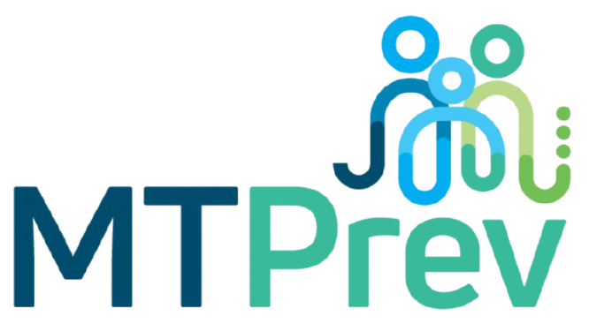

<p align="center">
  
</p>

<h1 align="center">MTPrev — Extensão Geral</h1>

<p align="center">
  Ferramentas para organizar a rotina com processos, expedientes e documentos no SPA e no SIGADOC.
</p>

<p align="center">
  <strong>Chrome · Firefox · SPA clássico · Workspace Coreplan · SIGADOC</strong>
</p>

---

## Sobre o projeto

O **MTPrev — Extensão Geral** nasceu para reunir, em um só lugar, tarefas que fazem parte do dia a dia de quem trabalha com processos administrativos e judiciais. Em vez de alternar entre várias telas, conferir documentos um por um e repetir os mesmos procedimentos, a extensão acrescenta ferramentas de consulta, triagem e organização aos sistemas já utilizados pela equipe.

Ela funciona como uma **camada de apoio** sobre o SPA da PGE/MT, incluindo o workspace da Coreplan, e sobre o SIGADOC. A extensão não substitui esses sistemas nem altera as permissões de acesso de quem a utiliza.

Seu princípio é simples: **automatizar o trabalho repetitivo e deixar as decisões processuais sob responsabilidade de quem analisa o caso**.

> **Versão indicada no manifesto do projeto:** `0.0.1`. Algumas funcionalidades podem variar conforme a versão dos arquivos instalada e a interface disponibilizada pelo SPA.

## O que você encontra no MTPrev

### Menu radial

O ponto de partida é o menu com a identidade visual do MTPrev. Ele pode ser arrastado pela tela, recolhido quando não está sendo usado e expandido para mostrar os módulos disponíveis. Ao selecionar uma ferramenta, o menu dá lugar ao painel de trabalho correspondente, sem precisar sair da página.

A interface utiliza painéis em tons escuros, botões com destaque ao passar o mouse e navegação organizada para ocupar menos espaço durante a análise dos processos.

### Triagem de processos e expedientes

A **Triagem** reúne comandos de apoio à leitura e ao tratamento dos expedientes da mesa de trabalho. Entre eles estão a abertura de processos em abas, a atualização da lista, a preparação de classificações e as rotinas de ciência, sempre de acordo com a tela e as permissões disponíveis.

No **workspace do SPA2**, a busca pode percorrer os processos carregados em lotes, mantendo os filtros da mesa. O painel informa o andamento da leitura e sinaliza quando não consegue confirmar a cobertura completa.

Há também recursos de diagnóstico para ajudar na identificação do tipo de demanda e das providências que merecem conferência. Esses apontamentos são **orientações de apoio**, não conclusões automáticas sobre o processo.

### Relatório de possíveis duplicatas

O relatório de **Duplicados** foi pensado para uma situação comum: encontrar mais de uma tarefa ou expediente relacionado ao mesmo processo e decidir o que realmente precisa ser conferido.

No SPA clássico, a análise aproveita os registros e os documentos disponibilizados pela interface. No workspace da Coreplan, a comparação considera principalmente:

- **Número do processo (CNJ)**, usado para reunir candidatos;
- **Partes ativas**, com normalização dos nomes quando possível;
- **Data de distribuição**, que pode coincidir ou apresentar divergências.

Os resultados aparecem em **grupos recolhidos**, com os expedientes lado a lado, suas informações principais e links para conferência. A pontuação de semelhança é uma **regra de triagem de 0 a 100**, e não uma probabilidade estatística de duplicidade.

No workspace, o relatório pode consultar as páginas em lotes, respeitando a mesa e os filtros selecionados. Quando a leitura termina, é possível abrir os candidatos em abas separadas. A versão com armazenamento local também permite **reabrir o último relatório completo sem repetir a coleta**; o botão **Atualizar** faz uma nova análise quando necessário.

A ferramenta também oferece ações de conferência e **sugestão de encerramento** onde a versão do SPA e o expediente permitem. Uma sugestão não equivale a um encerramento concluído: antes de qualquer gravação é necessário conferir o expediente, selecionar o motivo e confirmar a ação. Rotinas de lote no SPA2 devem ser tratadas como **assistidas e sujeitas a validação**, não como encerramentos automáticos garantidos.

### Relatório de peças

O módulo **Peças** ajuda a examinar expedientes e documentos PDF para identificar o tipo de manifestação a que se referem. Quando encontra informações suficientes, apresenta uma classificação sugerida e facilita o preenchimento dos campos correspondentes.

O relatório também organiza grupos prioritários para revisão, inclusive demandas relacionadas a contestação, agravo, pauta de julgamento e outras categorias previstas nas regras de trabalho. A leitura do documento oferece elementos para conferência; **não substitui a análise de seu conteúdo nem salva automaticamente uma classificação apenas por sugeri-la**.

### Prazos e gestão

O MTPrev reúne relatórios de **Prazos** e **Gestão** para consultar a situação da mesa, visualizar pendências e acompanhar informações úteis à organização do trabalho. Conforme a página e os dados disponíveis, é possível aplicar filtros, examinar os resultados e exportar relatórios.

Essas informações refletem as fontes consultadas. Um prazo que não apareceu no relatório não deve ser presumido inexistente sem conferência no sistema de origem.

### Autos, andamentos e PDFs

Nas páginas de processo, o painel **Autos do processo** facilita o acesso aos documentos associados ao expediente. Ele reúne fontes como autos, pasta do processo e, quando configurado, andamentos do PJe/TJMT.

Entre os recursos estão a organização de documentos por data, a abertura de PDFs, os filtros de leitura e a **pesquisa por palavras ou expressões dentro dos PDFs** já acessíveis à ferramenta. Dependendo da origem, o painel também oferece recursos para reunir ou consultar documentos do processo.

Nos PDFs unificados, a opção **Incluir capa MTPrev** acrescenta os dados disponíveis do processo à cópia de consulta. Na pesquisa interna, os resultados permitem abrir diretamente a página encontrada; páginas sem texto ou com imagem predominante são consideradas na indicação de leitura inconclusiva. Veja a [comparação com a extensão CDSP e os limites da adaptação](docs/comparacao-extensao-colega.md).

No SPA2, a integração utiliza as informações e as rotas fornecidas pela própria página, incluindo a aba de andamentos. A leitura de documentos é feita **sob demanda**, quando o usuário solicita uma fonte ou uma atualização; abrir o menu não significa baixar automaticamente todos os PDFs.

### Acompanhamento Especial de Processos

O **Acompanhamento Especial** permite informar um número CNJ e acompanhar alterações identificadas nas consultas ao PJe/TJMT.

A primeira consulta cria uma referência. As seguintes comparam as informações recebidas com a última situação conhecida. Enquanto o Chrome estiver aberto e o serviço estiver devidamente configurado, a verificação é programada para ocorrer **a cada 30 minutos**.

Os processos acompanhados aparecem em cards que podem ser expandidos para ver o histórico. Quando há novidades, a extensão destaca os registros não lidos, pode exibir uma notificação do navegador e mostra um **contador no menu radial**. O aviso permanece até ser marcado como lido, sem apagar o histórico.

O acompanhamento consulta movimentações e expedientes disponibilizados pelo serviço do PJe; **não verifica encerramentos internos do SPA**. Erros de consulta são apresentados separadamente, sem apagar a referência anterior.

### Ofícios e integração com o SIGADOC

O módulo de **Ofícios** auxilia o preenchimento e a tramitação de documentos no SIGADOC, integrando etapas que antes exigiam diversas intervenções manuais.

As rotinas incluem a escolha do tipo de documento, a conferência de classificação e destinatário, o preenchimento de campos, a preparação da assinatura e, nos fluxos compatíveis, a continuidade da juntada e da tramitação. Quando disponível, o PDF do expediente pode ser incluído como documento capturado.

Há modelos e rotinas para diferentes situações de trabalho, como solicitações de informações, cumprimento de decisões e outras demandas previstas no projeto. **Assinatura, protocolo e tramitação dependem de autorização, das credenciais necessárias e da conferência do usuário.**

## Como instalar

### Google Chrome ou Chromium

1. Baixe ou extraia a pasta do projeto.
2. Abra `chrome://extensions` e ative o **Modo do desenvolvedor**.
3. Clique em **Carregar sem compactação**.
4. Selecione a pasta que contém o arquivo `manifest.json`.
5. Recarregue as abas do SPA e do SIGADOC que já estiverem abertas.

O manifesto atual requer **Chrome 116 ou superior**. Ao atualizar uma instalação local, substitua os arquivos necessários **dentro da pasta existente**; não substitua a pasta inteira por engano. Após a atualização, clique em **Atualizar** na página de extensões.

### Firefox

Para gerar a versão de desenvolvimento para Firefox, é necessário **Firefox 128 ou superior** e **Node.js 18 ou superior**:

```bash
node scripts/build-firefox.js
```

Abra `about:debugging#/runtime/this-firefox`, escolha **Carregar extensão temporária** e selecione `dist/firefox/manifest.json`.

A instalação temporária precisa ser refeita após reiniciar o Firefox. A distribuição permanente exige um pacote assinado pela Mozilla.

### Configurações adicionais

Alguns recursos, especialmente a consulta de andamentos do PJe/TJMT, dependem da configuração e autorização de um serviço externo nas **opções da extensão**. Os demais recursos continuam sujeitos às permissões da conta utilizada no SPA ou SIGADOC.

### Levar a versão do GitHub para outro computador, com MCP

Os pacotes atualizados ficam versionados em **`dist/chrome-store`** (Chrome/Edge) e **`dist/firefox`**. Você pode carregá-los diretamente após clonar ou baixar o repositório, sem instalar dependências ou executar um build.

O Git não leva a configuração salva no navegador nem o arquivo privado `.local/test-credentials.json`. Por isso, apenas copiar o código não ativa o MCP no outro computador.

1. **Neste computador:** nas opções da extensão que funciona, clique em **Exportar configuração MCP**. Se a configuração vem de `.local/test-credentials.json`, execute `node scripts/export-mcp-settings.js`; o arquivo será criado em `.local/mtprev-mcp-settings.json`.
2. Leve **`mtprev-mcp-settings.json` separadamente**, por exemplo por pendrive. Ele contém a credencial do MCP e deve ficar fora do GitHub. A exportação inclui somente a configuração do MCP; senhas do SIGADOC e dados de processos não são exportados.
3. **No outro computador:** clone/baixe o repositório e carregue `dist/chrome-store` no Chrome/Edge ou `dist/firefox/manifest.json` no Firefox, conforme as instruções acima.
4. Abra as **Opções** da extensão → **Importar configuração MCP** → selecione o arquivo. Marque a autorização e clique em **Salvar e autorizar**.
5. Clique em **Testar conexão salva**. O teste confirma a ferramenta de consulta ao TJMT sem consultar processos. Depois, recarregue as abas do SPA.

Se o serviço responder HTTP 401/403, confira a credencial; HTTP 404 indica que é preciso conferir o endereço completo. Os builds `dist/local-test` e `dist/firefox-local-test` contêm configurações privadas e não fazem parte da distribuição para GitHub.

## Cuidados importantes

O MTPrev foi criado para **ajudar a conferir e organizar**, não para tomar decisões processuais de forma autônoma. Antes de marcar uma tarefa como conferida, sugerir encerramento, assinar um documento ou iniciar qualquer tramitação, confira as informações no sistema oficial.

- **Duplicidade sugerida não é duplicidade confirmada.** Números iguais podem corresponder a tarefas distintas de um mesmo processo.
- **Cobertura incompleta exige cautela.** Se a consulta não alcançou toda a mesa ou algum documento falhou, o relatório deve ser entendido como parcial.
- **Evite sobrecarregar o SPA.** Prefira consultas moderadas e use a versão salva dos relatórios quando não houver necessidade de atualização. Interrompa novas coletas durante instabilidades.
- **Proteja as credenciais e os dados processuais.** Não compartilhe cookies de sessão, tokens, senhas, PDFs restritos ou relatórios com pessoas não autorizadas.
- **Dados locais pertencem ao perfil do navegador.** A lista de acompanhamentos e os relatórios armazenados podem desaparecer ao limpar os dados ou remover a extensão.

A extensão é uma ferramenta complementar e **não representa uma funcionalidade oficial dos sistemas SPA, PJe ou SIGADOC**.

## Para quem desenvolve ou mantém o projeto

O repositório está organizado desta forma:

| Caminho | Conteúdo |
| --- | --- |
| `manifest.json` | Configuração da extensão e permissões. |
| `js/` | Painéis, automações, integrações e rotinas em segundo plano. |
| `css/` | Aparência do menu radial, painéis e temas. |
| `images/` | Logo, ícones e recursos visuais. |
| `data/` | Arquivos auxiliares utilizados por determinados relatórios. |
| `docs/` | Documentação técnica e notas sobre a adaptação ao SPA. |
| `tests/` | Testes automatizados e páginas locais de validação. |
| `scripts/` | Geração de pacotes para navegadores e publicação. |

Para executar a suíte automatizada:

```bash
node --test tests/*.test.cjs
```

Depois de alterar o código, gere novamente os dois pacotes versionados (Node.js 18 ou superior; funciona também no Windows, sem `npm install` ou `zip`):

```bash
node scripts/build-github.js
```

Inclua as alterações de `dist/chrome-store` e `dist/firefox` no mesmo commit dos fontes, para que o outro computador receba o mesmo código. Veja também [as instruções dos pacotes](dist/README.md).

Para gerar o pacote de publicação do Chrome:

```bash
node scripts/build-chrome-store.js
```

Os testes locais não substituem a validação supervisionada em ambiente autenticado, especialmente nas operações que **gravam informações, assinam documentos ou movimentam processos**.

Outras referências do repositório: [instruções de carregamento](README_CARREGAR.txt), [guia de atualizações](GUIA_DE_UPDATES.txt), [menu radial](docs/menu-radial.md), [adequação ao POP MTPrev](docs/adequacao-pop-mtprev.md) e [publicação na Chrome Web Store](store/LEIA-ME.md).

---

<p align="center">
  <strong>MTPrev — Extensão Geral</strong><br>
  Desenvolvido por Arthur Costa Dias.<br>
  Mais agilidade nas tarefas repetitivas. Mais tempo para a análise que realmente importa.
</p>
